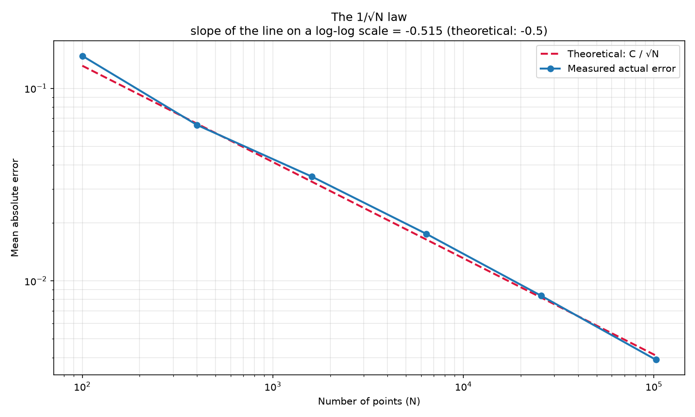
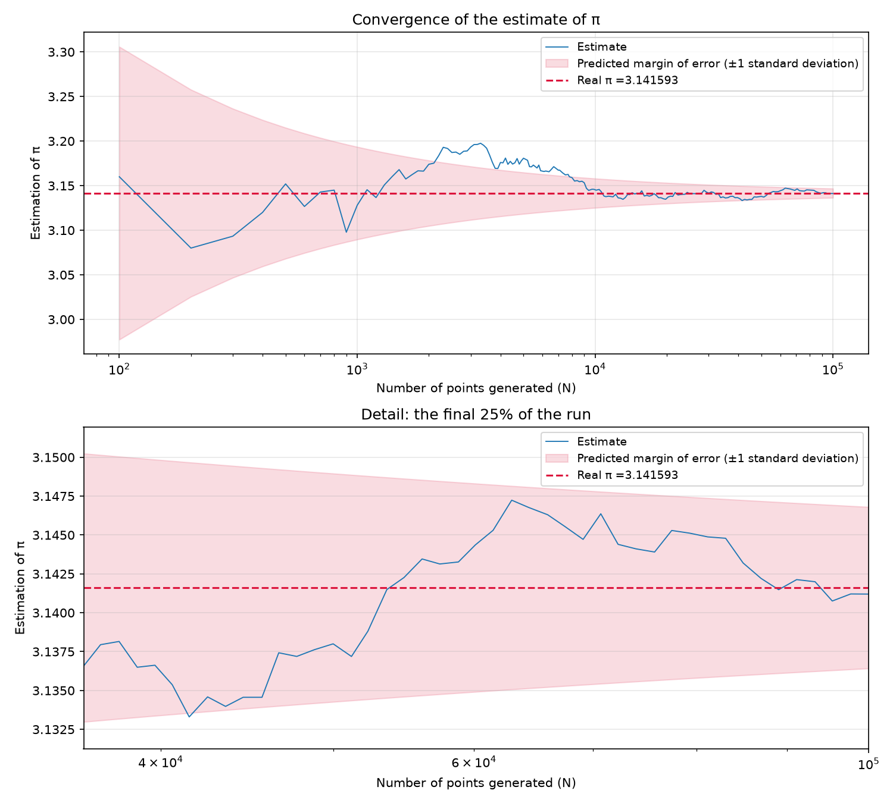

# Estimating π with Monte Carlo

[](https://www.python.org/)
[](https://numpy.org/)
[](https://matplotlib.org/)

A statistical estimation of π, written to do more than "get a number": it
**demonstrates the 1/√N convergence law** that governs every Monte Carlo
method, with a theoretical error model that the experiments confirm
numerically and visually.

---

## Table of contents

- [Why](#why)
- [How it works](#how-it-works)
- [What it demonstrates](#what-it-demonstrates)
- [Results](#results)
- [Installation](#installation)
- [Usage](#usage)
- [Project structure](#project-structure)
- [Key takeaways](#key-takeaways)

---

## Why

The classic Monte Carlo trick is well known: scatter random points inside a
square, count how many land inside the inscribed circle, and

```
π ≈ 4 · (points inside the circle) / (total points)
```

Most implementations stop there. This project goes one step further and
answers the interesting question: **how fast does the estimate improve?**

The answer — the 1/√N law — is the same law behind scientific simulations,
Monte Carlo pricing in finance, and uncertainty quantification in physics.
This repo makes it tangible with reproducible experiments.

---

## How it works

1. **Sampling.** `N` points are drawn uniformly from the square
   `[-1, 1] × [-1, 1]` using a vectorized NumPy generator. Each point is a
   Bernoulli trial: it falls inside the unit circle with probability

   ```
   p = area(circle) / area(square) = π / 4
   ```

2. **Estimation.** The proportion of points inside the circle multiplied by
   4 is the estimate of π.

3. **Error model.** For a Bernoulli trial, σ = √(p(1−p)). Propagating that
   through the estimator gives the standard deviation of the estimate:

   ```
   σ(π̂) = 4 · √(p(1−p)) / √N
   ```

   and the expected mean absolute error is `σ(π̂) · √(2/π)`. These constants
   are computed once at the top of `montecarlo_pi.py` and reused everywhere,
   including the plots.

4. **Two experiments.**
   - The **1/√N law table** repeats the experiment many times per value of
     `N` and averages the errors, so the law emerges from the noise instead
     of a single lucky run.
   - The **convergence curve** records the estimate after every point,
     showing how the running value settles toward π.

5. **Persistence and plotting.** Results are saved as JSON in `results/`,
   and `plot_results.py` turns them into the charts below.

---

## What it demonstrates

| Concept | Where |
| --- | --- |
| Monte Carlo estimation of π | `cal_pi()` |
| The 1/√N error law, verified numerically | `law_table()`, `plot_law()` |
| Why repetitions matter (a single run proves nothing) | averaging in `law_table()` |
| Convergence of a running estimate | `convergence_curve()`, `plot_convergence()` |
| Reproducibility via a random seed | `--seed` |
| Defensive input validation | `positive_integer()`, `argparse` types |
| A memory guard before allocating GBs of RAM | `BYTES_PER_POINT`, `--force` |
| Separation of computation / persistence / presentation | module sections |

---

## Results

Run the simulation and generate the charts:

```bash
python montecarlo_pi.py --save
python plot_results.py
```

### The 1/√N law

On a log–log scale, the measured error follows a straight line with slope
**−0.5**, exactly as predicted by theory:



### Convergence of the estimate

The estimate narrows around the true value of π within the predicted
±1σ band, which itself shrinks as 1/√N:



Representative console output (`python montecarlo_pi.py -s`, random seed):

```
  Estimation of pi via Monte Carlo
  Seed: random

  Law of 1/√N   (100 repetitions per value of N)

           N  estimated value of π   true error  theoretical error        error x √N
  ------------------------------------------------------------------------
         100       3.14680      0.14747         0.13103            1.4747
         400       3.12850      0.06452         0.06551            1.2905
       1,600       3.14035      0.03482         0.03276            1.3927
       6,400       3.14098      0.01753         0.01638            1.4026
      25,600       3.14199      0.00837         0.00819            1.3391
     102,400       3.14147      0.00389         0.00409            1.2457
 ------------------------------------------------------------------------

  The last column should stay close to 1.31
  Observed average: 1.3575

  To reduce the error by half, N must be multiplied by 4.
  To gain one more decimal place, you must multiply N by 100.
```

Note the `error × √N` column: it stays close to **1.31** — the theoretical
constant — no matter how large `N` gets. That is the 1/√N law being verified
numerically.

---

## Installation

Requires **Python 3.10+**.

```bash
git clone https://github.com/rymi14/monte-carlo-pi
cd pi

python3 -m venv .venv
source .venv/bin/activate
pip install -r requirements.txt
```

---

## Usage

Run it with no arguments for an interactive session that explains each
parameter as it asks, or pass everything explicitly:

```bash
# Interactive mode (guides you through every option)
python montecarlo_pi.py

# Explicit parameters
python montecarlo_pi.py --n 100 1000 10000 100000 --repetitions 500 --save

# One million points on the convergence curve, reproducible
python montecarlo_pi.py --convergence 1000000 --seed 42

# Generate the charts from saved results
python plot_results.py
```

### Command-line options

| Option | Description | Default |
| --- | --- | --- |
| `-n, --n N [N ...]` | Values of N for the 1/√N law table | `100 400 1600 6400 25600 102400` |
| `-r, --repetitions R` | Repetitions per value of N (averages out luck) | `100` |
| `-c, --convergence N` | Points for the convergence curve | `100000` |
| `-b, --batch K` | Minimum resolution of the recorded curve | `100` |
| `-S, --seed S` | Seed for reproducible results | random |
| `-s, --save` | Save results as JSON in `results/` | off |
| `--force` | Bypass the 1.5 GB memory safety limit | off |

---

## Project structure

```
pi/
├── montecarlo_pi.py   # Simulation, error model, CLI, and JSON persistence
├── plot_results.py    # Charts from the saved JSON (log-log law + convergence)
├── requirements.txt   # numpy, matplotlib
├── results/           # Generated JSON (git-ignored)
└── img/               # Generated PNGs (versioned for this README)
```

The code is organized in clear sections — theoretical constants, input
handling, calculation, presentation, persistence, and CLI — so each part
can be read and modified independently.

---

## Key takeaways

- **Monte Carlo converges slowly.** To gain one more decimal digit you need
  100× more points — that is the 1/√N law in practice.
- **A single run proves nothing.** The law lives in the *average* of many
  repetitions; one experiment can be misleadingly good or bad.
- **Theory and experiment agree.** The measured `error × √N` stays near the
  predicted constant, and the log–log slope sits at −0.5.
- **Reproducibility is cheap.** A single `--seed` makes the whole experiment
  repeatable.
